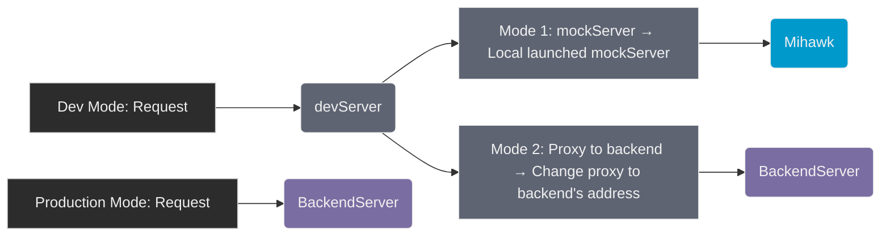

# Mihawk (simple tiny mock-server)

[](https://www.npmjs.com/package/mihawk)
[](https://www.npmjs.com/package/mihawk)
[](https://github.com/Froguard/mihawk/issues?q=is%3Aopen+is%3Aissue)
[](https://github.com/Froguard/mihawk/blob/master/LICENSE)

<!-- [](https://www.npmjs.com/package/mihawk) -->

> 🇨🇳 中文版说明 → [README.zh-CN.md](https://github.com/Froguard/mihawk/blob/master/README.zh_CN.md)

> Recommend: use version@`v1.0.0`+

Make a easy mock-server to mock api, with `GET /a/b/c` → `./mocks/data/GET/a/b/c.json` mapping

- ✔️ Zero intrusion into front-end code
- ✔️ Support https protocol
- ✔️ Support all methods, like `GET`, `POST`, `PUT`, `DELETE` etc.
- ✔️ Support mock data file type: `json` | `json5`
- ✔️ Support custom middleware in `middleware.{js|cjs|ts}` using Koa middleware (the current runtime is Koa 3); Express middleware is also supported with `func.isExpress=true`
- ✔️ Support custom route mappings in `routes.{json|json5|js|cjs|ts}`; route keys support glob patterns, so multiple requests can reuse the same mock file
- ✔️ Support mock logic file type: `js` | `cjs` | `ts`
- ✔️ Support WebSocket simulations, including optional custom logic in `socket.{js|cjs|ts}`
- ✔️ Support the generation of some simple simulation data, in `mihawk/tools`, eg: `createRandPhone`、`createRandEmail`

## Install

```sh
npm i -g mihawk
```

## Usage

```sh
mihawk --port=8888
# mihawk -p 8888
```

> then open browser and visit `http://localhost:8888`
>
> mock data directory: `./mocks/data`

```sh
./mocks
    │
    ├── /data
    │   │
    │   ├── DELETE
    │   │     ├──/*.{js|cjs|ts} DELETE request resolve logic
    │   │     └──/*.{json|json5} DELETE request resolve data
    │   │
    │   ├── GET
    │   │     ├──/*.{js|cjs|ts} GET request resolve logic
    │   │     └──/*.{json|json5} GET request resolve data
    │   │
    │   ├── POST
    │   │     ├──/*.{js|cjs|ts} POST request resolve logic
    │   │     └──/*.{json|json5} POST request resolve data
    │   │
    │   └── PUT
    │         ├──/*.{js|cjs|ts} PUT request resolve logic
    │         └──/*.{json|json5} PUT request resolve data
    │
    ├── middleware.{js|cjs|ts}       [optional] custom middleware
    ├── socket.{js|cjs|ts}           [optional] custom WebSocket logic
    │
    └── routes.{json|json5|js|cjs|ts} [optional] route mappings
```

> mapping：

```sh
request    ： GET http://localhost:8888/a/b/c/d
JSON-file  ： data/GET/a/b/c/d.json
mock-file  :  data/GET/a/b/c/d.js
```

- `request`: mock request url
- `JSON-file`: mock origin data
- `mock-file`: resolve mock logic, base on origin data

Finally, the return data will be the data after processing mock-file (the `mock-file`) with origin data (the `JSON-file`)

## Usage-Recommend ✅

> A more recommended way to use it is to write all config props into the `.mihawkrc.json` in the root directory
>
> And then run `mihawk` in you shell

### init a rc file `.mihawkrc.json`

```sh
mihawk init
```

> then edit the `.mihawkrc.json` to customize your config

```json
{
  "host": "0.0.0.0",
  "port": 8888,
  "https": false,
  "cors": true,
  "cache": false,
  "watch": true,
  "mockDir": "mocks",
  "mockDataFileType": "json",
  "mockLogicFileType": "none",
  "autoCreateMockLogicFile": false
}
```

About root config props:

- `host`: string, default `0.0.0.0`, server listen on this host
- `port`: number, default `8888`, server listen on this port
- `https`: boolean | { key: string; cert: string; ca?: string }, default `false`. Set it to `true` to use the bundled development certificate, or provide certificate file paths. If `key` or `cert` is omitted or its path does not exist, Mihawk falls back to the bundled certificate; other file read errors are propagated
- `cors`: boolean, default `true`, if `true`, will add `Access-Control-Allow-Origin: *` (and other necessary cors props in headers ) to the response headers
- `cache`: boolean, default `false`. If `true`, loaded mock data and logic modules may be reused until their caches are refreshed
- `watch`: boolean, default `true`. When started through the CLI, Mihawk watches `mockDir`; JSON changes refresh data caches, while logic, template, and `routes.{json|js|cjs|ts}` changes restart the server. With `mockLogicFileType: "none"` and `mockDataFileType: "json5"`, changes to `routes.json5` currently require a manual restart
- `mockDir`: string, default `mocks`, the directory of mock data
- `mockDataFileType`: string `json` | `json5`, default `json`, the file type of mock data
- `mockLogicFileType`: string `js` | `cjs` | `ts` | `none`, default `none`, the file type of mock logic (`javascript` and `typescript` are also accepted aliases)
- `autoCreateMockLogicFile`: boolean, default `false`. When logic mode is enabled, create a missing logic file when its route is requested
- `tsconfigPath`: string | null, only used in TypeScript logic mode. If omitted, Mihawk checks `<mockDir>/tsconfig.json` and otherwise uses its built-in TypeScript configuration
- `logConfig`: { ignoreRoutes?: string[] } | null, default `null`; matching paths or `METHOD /path` patterns are excluded from request logs
- `socketConfig`: boolean | { stomp?: boolean } | null, disabled by default. `true` enables WebSocket on the same HTTP/HTTPS server and port. `stomp` enables STOMP parsing in the built-in handler; a custom socket resolver receives the flag and handles messages itself
- `setJsonByRemote`: { enable: boolean; target: string; timeout?: number; changeOrigin?: boolean; rewrite?: (path: string) => string; coverExistedJson?: boolean } | null
  - Default: `undefined`
  - When the local JSON file is missing, `{ enable: true, target: 'https://...' }` fetches initial data from the remote service
  - When the local JSON file already exists, remote data is requested and written only when `coverExistedJson: true`; otherwise the local file is used directly
  - Set it to `null`/`undefined`, or set `enable: false`, to disable remote loading
  - Proxy config requires:
    - `target`(required): remote server URL, **required**
    - `rewrite`: optional path rewrite function; use a JavaScript or TypeScript RC file because JSON cannot contain functions
    - `timeout`: request timeout in milliseconds, default `10000`
    - `changeOrigin`: when `true`, add the target host as a forwarded `Host` value. The original lowercase `host` header is currently retained, so Fetch may combine both values
    - `coverExistedJson`: when `true`, try to overwrite an existing local JSON file on every request; a failed remote request falls back to the local file

> Remote responses must be JSON objects. Invalid responses and request failures fall back to the JSON template or built-in initial data when the local file is missing. See [fallback-remote.md](./docs/fallback-remote.md) for the exact flow and URL restrictions.

> More detail → [src/com-types.ts](https://github.com/Froguard/mihawk/blob/master/src/com-types.ts), interface MihawkRC define the config props

### Config-driven files

Mihawk loads file extensions from the configured data and logic modes:

| `mockLogicFileType` | Routes file                 | Custom middleware | Per-route logic | Custom WebSocket logic |
| ------------------- | --------------------------- | ----------------- | --------------- | ---------------------- |
| `none`              | `routes.<mockDataFileType>` | Not loaded        | Not loaded      | Not loaded             |
| `js`                | `routes.js`                 | `middleware.js`   | `data/**/*.js`  | `socket.js`            |
| `cjs`               | `routes.cjs`                | `middleware.cjs`  | `data/**/*.cjs` | `socket.cjs`           |
| `ts`                | `routes.ts`                 | `middleware.ts`   | `data/**/*.ts`  | `socket.ts`            |

Custom WebSocket logic is loaded only when `socketConfig` is enabled. WebSocket itself can still run with its built-in handler when `mockLogicFileType` is `none`.

Route keys can match either a path such as `/users/*` or a method-qualified path such as `GET /users/*`. Rules are checked in declaration order and the first match wins. Route values are paths relative to `<mockDir>/data`.

### WebSocket logic

Set `socketConfig` to `true` to use Mihawk's built-in WebSocket greeting and echo handler. The following TypeScript example also requires `mockLogicFileType: "ts"` and a `mocks/socket.ts` file:

```ts
import type { SocketResolveFunc } from 'mihawk/com-types';

const resolveSocket: SocketResolveFunc = (socket, request, options) => {
  socket.on('message', message => {
    socket.send(message.toString());
  });

  console.log(request.url, options?.clientId, options?.stomp);
};

export default resolveSocket;
```

WebSocket always shares the root `host`, `port`, and HTTPS setting. The `socketConfig` object currently reads only `stomp`; separate socket host/port settings are not used.

### Debug response headers

- `X-Mock-Hit`: `1` when the default file-based mock handled the request; `0` when `skipDefaultMock` reaches it. The header is absent if an earlier middleware ends the response without calling `next()`
- `X-Mock-Use-Remote`: `1` when remote data was used
- `X-Mock-Use-Default`: `1` when built-in initial data was used
- `X-Mock-Use-Logic`: the logic extension (`js`, `cjs`, or `ts`) after the converter completes successfully; otherwise `none`
- `X-Mock-Time`: downstream processing time measured from the `common` middleware; absent if the request completes before reaching `common`

## Config with Build tools



> In the above diagram, `devServer` is typically provided by bundling tools during local development, such as Vite or Webpack, which have corresponding configuration options.

> Essentially, it is based on the proxy functionality of `devServer`, forwarding requests to the mihawk server.

### vite

in `vite.config.js` file:

```js
import { defineConfig } from 'vite';
export default defineConfig({
  server: {
    proxy: {
      '/api': {
        target: 'http://localhost:8888', // mihawk server address
        changeOrigin: true,
        rewrite: path => path.replace(/^\/api/, ''),
      },
    },
  },
});
```

### webpack

in `webpack.config.js` file:

```js
// webpack.config.js
module.exports = {
  devServer: {
    proxy: {
      '/api': {
        target: 'http://localhost:8888', // mihawk server address
        changeOrigin: true,
        pathRewrite: { '^/api': '' },
      },
    },
  },
};
```

## Example

For request `GET /api/fetch_a_random_number`，it return response with random number data

### 1.create `mocks/data/GET/api/fetch_a_random_number.json` file, content as below

```json
{
  "code": 200,
  "data": 123456,
  "msg": "success"
}
```

> You cal aslo dont do this step, coz the mock data file is auto create when request a not exists file

Now, if request `GET /api/fetch_a_random_number`，return data is `123456`, it is fixed data

### 2.Enable JavaScript logic mode and create `mocks/data/GET/api/fetch_a_random_number.js`

First set `mockLogicFileType` to `js` in `.mihawkrc.json`; otherwise Mihawk does not load `.js` logic files. Then create the file with the following content:

```js
module.exports = async function (oldJson) {
  oldJson.data = Math.floor(Math.random() * 1000000); // generate random number
  return oldJson; // return data, it is required
};
```

Start `mihawk` server now, if request `GET /api/fetch_a_random_number`，return data is random number, each request return a different data

> About MockLogic File:
>
> - Both support `js` | `cjs` | `ts`, the process is same。Attention to `export default` is necessary in `ts` file!
> - `autoCreateMockLogicFile` defaults to `false`. When logic mode is enabled, set it to `true` to create a missing mock logic file when its route is requested
> - Of course, it is worth mentioning that **MockLogic files aren't necessary files**. If there is no logical demand for data processing, **using only JSON files can also simulate the request**

## More example of mocks files

### `routes` file demo in ts

This example requires `mockLogicFileType: "ts"` and the file name `mocks/routes.ts`.

```ts
/**
 * mihawk's routes file:
 */
const routes: Record<string, string> = {
  'GET /test': './GET/test',
  'GET /test-*': './GET/test', // key: routePath，support glob expression; value:  mock data file path (no ext)
};
//
export default routes;
```

### `middleware` file demo in ts

This example requires `mockLogicFileType: "ts"` and the file name `mocks/middleware.ts`.

```ts
/**
 * mihawk's middleware file:
 * - a Koa middleware (Mihawk currently uses Koa 3)
 */
import type { KoaContext, KoaNext } from 'mihawk/com-types';

/**
 * Middleware functions, to implement some special data deal logic,
 * - This function exec before the default-mock-logic. Simply return or don`t call "await next()" could skip default-mock-logic
 * - This function is a standard KOA middleware that follows the KOA onion ring model
 * - see more：https://koajs.com/#middleware
 * @param {Context} ctx
 * @param {Next} next
 * @returns {Promise<void>}
 */
export default async function middleware(ctx: KoaContext, next: KoaNext) {
  // do something here
  console.log(ctx.url);
  if (ctx.path === '/diy') {
    ctx.body = 'it is my diy logic';
  } else {
    await next(); // default logic (such like mock json logic)
  }
}
```

> Set `middleware.isExpress=true` to explicit definition a express middleware function before export, if you write in express-stype
> Other complex custom middleware examples based on `@koa/router` and `koa-compose`: [middleware.md](./docs/middleware.md)

### `mock-logic` file demo in ts

```ts
'use strict';
/**
 * GET /xxx
 * This file isn’t mandatory. If it is not needed (such as when there is no need to modify response data), it can be deleted directly
 */

/**
 * Mock data resolve function, the original data source is the JSON file with the same name as this file
 * @param {object} originData (mocks/data/GET/xxx.json)
 * @param {MhkCvtrExtra} extra { url,method,path,query,body }
 * @returns {object} newData
 */
export default async function convertData(originData: Record<string, any>, extra: Record<string, any>) {
  // write your logic here...
  originData.newProp = 'newPropXxx';
  return originData; // return data, it is required
}
```

### JSON data template

> Customize the initial content of auto-created JSON files via EJS templates, see [json-data-tpl.md](./docs/json-data-tpl.md)

## Differences from Mockjs?

### 1. Different positioning

- Mockjs is a front-end mockjs library that provides powerful simulated data generation capabilities
- Mihawk is a Node.js mock service that can be used with front-end projects or standalone; it provides mock capabilities for httpServer/SocketServer based on Nodejs

### 2. Different implementation methods

- Mockjs intercepts requests and returns simulated data by hijacking xhr/fetch, etc., which requires certain modifications to front-end engineering code, and there are some differences in the request sending/receiving process compared to the real online environment
- Mihawk handles requests through a local Koa server (the current runtime is Koa 3) without modifying front-end request code. Requests use the normal HTTP/WebSocket transport, while response status, headers, and data still follow the configured mock behavior

### 3. Common usage scenarios

- Mockjs is used for simulated data production, generating corresponding fake data through its specific syntax
- Mihawk is used to simulate a BackendServer based on Node.js, such as WebSocket and HTTP servers, combined with simple data generation functions to create fake data
  - `mihawk/tools`: Built-in utility functions like `createRandXxx` for generating fake data; this functionality is not as powerful as Mockjs
    - Consider using both mockjs's `data generate` and mihawk's `server mock` together; they are not mutually exclusive
  - `your_project/mocks/middleware.ts`: Simulate backend services, such as httpServer
  - `your_project/mocks/socket.ts`: Simulate backend services, such as socketServer
