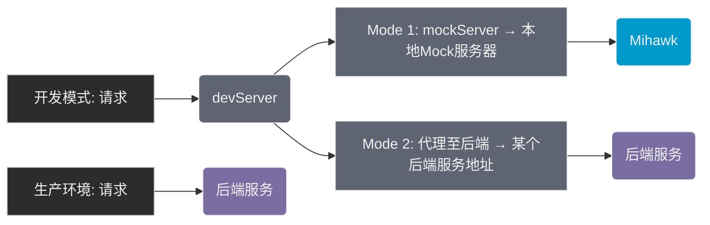

# Mihawk (简单小巧的 MockServer 工具)

[](https://www.npmjs.com/package/mihawk)
[](https://www.npmjs.com/package/mihawk)
[](https://github.com/Froguard/mihawk/issues?q=is%3Aopen+is%3Aissue)
[](https://github.com/Froguard/mihawk/blob/master/LICENSE)

<!-- [](https://www.npmjs.com/package/mihawk) -->

> 🇺🇸 English → [README.md](https://github.com/Froguard/mihawk/blob/master/README.md)

> 推荐使用版本 `v1.0.0`+

采用 `GET /a/b/c` → `./mocks/data/GET/a/b/c.json` 方式去做 api 请求的 mock server 工具

- ✅ 对于项目的前端代码零侵入
- ✅ 支持 https 协议
- ✅ 支持所有有请求方法，例如 `GET`, `POST`, `PUT`, `DELETE` 等，通过文件路径方式自动映射请求路径
- ✅ 用以定义 mock 的数据文件，同时支持 `json` | `json5` 两种格式
- ✅ 用以处理 mock 数据的逻辑文件，支持 `js` | `cjs` | `ts` 三种格式，可以对 json 请求进行二次修改，以便于支持一些动态逻辑处理
- ✅ 在默认文件映射之外，支持通过 `middleware.{js|cjs|ts}` 编写 Koa 中间件（当前运行时为 Koa 3）；设置 `func.isExpress=true` 后也兼容 Express 中间件
- ✅ 支持 `routes.{json|json5|js|cjs|ts}` 自定义路由映射，key 支持 glob 表达式，可让多条请求复用同一个 mock 文件
- ✅ 支持 WebSocket 模拟，并可通过 `socket.{js|cjs|ts}` 编写自定义处理逻辑
- ✅ 通过 `mihawk/tools` 提供一些简单的函数，便于模拟数据的生成，如: `createRandPhone`、`createRandEmail`

## 安装

```sh
npm i -g mihawk
```

## 使用

```sh
mihawk --port=8888
# mihawk -p 8888
```

> 打开网页 `http://localhost:8888`
>
> mock 文件夹: `./mocks/data`

```sh
./mocks
    │
    ├── /data
    │   │
    │   ├── DELETE
    │   │     ├──/*.{js|cjs|ts} DELETE 请求处理逻辑
    │   │     └──/*.{json|json5} DELETE 请求对应的数据
    │   │
    │   ├── GET
    │   │     ├──/*.{js|cjs|ts} GET 请求处理逻辑
    │   │     └──/*.{json|json5} GET 请求对应的数据
    │   │
    │   ├── POST
    │   │     ├──/*.{js|cjs|ts} POST 请求处理逻辑
    │   │     └──/*.{json|json5} POST 请求对应的数据
    │   │
    │   └── PUT
    │         ├──/*.{js|cjs|ts} PUT 请求处理逻辑
    │         └──/*.{json|json5} PUT 请求对应的数据
    │
    ├── middleware.{js|cjs|ts}       [optional] 自定义中间件
    ├── socket.{js|cjs|ts}           [optional] 自定义 WebSocket 逻辑
    │
    └── routes.{json|json5|js|cjs|ts} [optional] 全局路由映射
```

> 路由与文件的映射关系

```sh
request    ： GET http://localhost:8888/a/b/c/d
JSON-file  ： data/GET/a/b/c/d.json
mock-file  :  data/GET/a/b/c/d.js
```

- `request`: 模拟的请求路径
- `JSON-file`: mock 用的原始 json 数据
- `mock-file`: mock 的处理逻辑文件，可以修改 json 数据，例如添加一些自定义的属性等

最终请求的返回结果，将会是经由 mock-file 处理 JSON-file 后的数据

## 推荐用法

> 比较推荐的办法是，通过在根目录下，自定义一个 `.mihawkrc.json` 文件，用来完成配置项的编写
>
> 然后运行 `mihawk` 命令

### 初始化 `.mihawkrc.json`

```sh
mihawk init
```

> 然后编辑该文件，完成配置

```json
{
  "host": "0.0.0.0",
  "port": 8888,
  "https": false,
  "cors": true,
  "cache": false,
  "watch": true,
  "mockDir": "mocks",
  "mockDataFileType": "json",
  "mockLogicFileType": "none",
  "autoCreateMockLogicFile": false
}
```

关于这里边的配置项：

- `host`: string，默认值为 `0.0.0.0`，server 将监听该地址
- `port`: number, 默认值为 `8888`，server 将监听该端口
- `https`: boolean | { key: string; cert: string; ca?: string }，默认值为 `false`。设置为 `true` 时使用内置开发证书；设置为对象时读取指定证书文件。`key` 或 `cert` 未配置或对应路径不存在时会回退到内置证书；其他文件读取错误会直接抛出
- `cors`: boolean, 默认值为 `true`，如果为 `true`，则添加 `Access-Control-Allow-Origin: *` 等等跨域相关的到响应头
- `cache`: boolean，默认值为 `false`。为 `true` 时可以复用已加载的 mock 数据和逻辑模块，直到对应缓存被刷新
- `watch`: boolean，默认值为 `true`。通过 CLI 启动时会监听 `mockDir`：JSON 变化会刷新数据缓存，逻辑、模板以及 `routes.{json|js|cjs|ts}` 变化会重启服务。当 `mockLogicFileType: "none"` 且 `mockDataFileType: "json5"` 时，修改 `routes.json5` 目前需要手动重启
- `mockDir`: string, 默认值为 `mocks`，表示 mock 数据的目录
- `mockDataFileType`: string 可选值为 `json` | `json5` 之一, 默认值为 `json`，表示 mock 数据的文件格式
- `mockLogicFileType`: string，可选值为 `js` | `cjs` | `ts` | `none`，默认值为 `none`；也接受 `javascript` 和 `typescript` 别名
- `autoCreateMockLogicFile`: boolean，默认值为 `false`。启用逻辑模式后，请求对应路由时可自动创建缺失的逻辑文件
- `tsconfigPath`: string | null，仅在 TypeScript 逻辑模式下生效。未配置时先检查 `<mockDir>/tsconfig.json`，文件不存在则使用内置 TypeScript 配置
- `logConfig`: { ignoreRoutes?: string[] } | null，默认值为 `null`；匹配 path 或 `METHOD /path` 模式的请求不会打印请求日志
- `socketConfig`: boolean | { stomp?: boolean } | null，默认关闭。设置为 `true` 时在同一个 HTTP/HTTPS 服务和端口上启用 WebSocket；`stomp` 会让内置处理逻辑解析 STOMP，自定义 socket resolver 只会收到该标记并自行处理消息
- `setJsonByRemote`: { enable: boolean; target: string; timeout?: number; changeOrigin?: boolean; rewrite?: (path: string) => string; coverExistedJson?: boolean } | null
  - 默认值: `undefined`
  - 本地 JSON 文件不存在时，设置 `{ enable: true, target: 'https://...' }` 会从远端服务获取初始化数据
  - 本地 JSON 文件已经存在时，只有 `coverExistedJson: true` 才会请求远端并写回本地；否则直接使用本地文件
  - 设置为 `null`/`undefined`，或者设置 `enable: false` 时禁用远端加载
  - 代理配置要求:
    - `target`(必填): 远端服务器URL，该值为必须值
    - `rewrite`: 可选路径重写函数；JSON 无法保存函数，因此需要使用 JavaScript 或 TypeScript RC 文件
    - `timeout`: 请求超时时间（毫秒），默认 `10000`
    - `changeOrigin`: 为 `true` 时将目标 host 添加为转发的 `Host` 值。当前不会移除原始的小写 `host` 请求头，因此 Fetch 可能合并两个值
    - `coverExistedJson`: 为 `true` 时每次请求都会尝试覆盖已有本地 JSON；远端失败时回退到本地文件

> 远端响应必须是 JSON 对象。本地文件不存在时，如果远端请求失败或响应无效，会继续回退到 JSON 模板或内置初始数据。完整流程和 URL 限制见 [fallback-remote.zh_CN.md](./docs/fallback-remote.zh_CN.md)。

> 更多说明，详见 ts 定义文件 → [src/com-types.ts](https://github.com/Froguard/mihawk/blob/master/src/com-types.ts), interface MihawkRC 定义了所有配置项

### 配置决定的文件

Mihawk 会根据数据和逻辑模式加载对应后缀的文件：

| `mockLogicFileType` | routes 文件                 | 自定义 middleware | 单路由逻辑      | 自定义 WebSocket 逻辑 |
| ------------------- | --------------------------- | ----------------- | --------------- | --------------------- |
| `none`              | `routes.<mockDataFileType>` | 不加载            | 不加载          | 不加载                |
| `js`                | `routes.js`                 | `middleware.js`   | `data/**/*.js`  | `socket.js`           |
| `cjs`               | `routes.cjs`                | `middleware.cjs`  | `data/**/*.cjs` | `socket.cjs`          |
| `ts`                | `routes.ts`                 | `middleware.ts`   | `data/**/*.ts`  | `socket.ts`           |

只有启用 `socketConfig` 时才会加载自定义 WebSocket 逻辑。`mockLogicFileType` 为 `none` 时，WebSocket 仍可使用内置处理逻辑运行。

routes 的 key 可以匹配 `/users/*` 这样的 path，也可以匹配 `GET /users/*` 这样的“方法 + path”。规则按声明顺序检查，第一个匹配项生效；value 是相对于 `<mockDir>/data` 的路径。

### WebSocket 逻辑

将 `socketConfig` 设置为 `true` 时，可以直接使用 Mihawk 内置的 WebSocket 欢迎消息和回显处理。下面的 TypeScript 示例还需要设置 `mockLogicFileType: "ts"`，并保存为 `mocks/socket.ts`：

```ts
import type { SocketResolveFunc } from 'mihawk/com-types';

const resolveSocket: SocketResolveFunc = (socket, request, options) => {
  socket.on('message', message => {
    socket.send(message.toString());
  });

  console.log(request.url, options?.clientId, options?.stomp);
};

export default resolveSocket;
```

WebSocket 始终复用根配置中的 `host`、`port` 和 HTTPS 设置。`socketConfig` 对象目前只读取 `stomp`，单独配置 socket host/port 不会生效。

### 调试响应头

- `X-Mock-Hit`：默认文件 mock 处理请求时为 `1`；设置 `skipDefaultMock` 且执行到默认 mock 时为 `0`。如果前置中间件不调用 `next()` 就结束响应，则不会出现该响应头
- `X-Mock-Use-Remote`：使用远端数据时为 `1`
- `X-Mock-Use-Default`：使用内置初始数据时为 `1`
- `X-Mock-Use-Logic`：逻辑转换函数成功完成时为 `js`、`cjs` 或 `ts`，否则为 `none`
- `X-Mock-Time`：从 `common` 中间件开始计算的下游处理耗时；请求在到达 `common` 前结束时不会出现该响应头

## 在常见的打包工具中，配置 Mihawk



> 上图中 `devServer` 一般为本地开发时候的打包工具可提供，如 vite，webpack 等，均有对应配置

> 本质上就是基于 `devServer` 的代理功能，将请求转发至 `mihawk` 服务器

### vite

配置 `vite.config.js` 文件:

```js
import { defineConfig } from 'vite';
export default defineConfig({
  server: {
    proxy: {
      '/api': {
        target: 'http://localhost:8888', // mihawk server address
        changeOrigin: true,
        rewrite: path => path.replace(/^\/api/, ''),
      },
    },
  },
});
```

### webpack

配置 `webpack.config.js` 文件:

```js
// webpack.config.js
module.exports = {
  devServer: {
    proxy: {
      '/api': {
        target: 'http://localhost:8888', // mihawk server address
        changeOrigin: true,
        pathRewrite: { '^/api': '' },
      },
    },
  },
};
```

## 示例

假设有一个请求 `GET /api/fetch_a_random_number`，返回一个随机数，那么可以这样写：

### 1.创建一个 `mocks/data/GET/api/fetch_a_random_number.json` 文件，内容如下

```json
{
  "code": 200,
  "data": 123456,
  "msg": "success"
}
```

> 注意，这一步也可以不通过手动创建，当请求发过来的时候，如果文件不存在，会自动创建一个空的 json 文件，并返回给客户端，然后在这个自动创建的文件里修改即可

此时，如果请求 `GET /api/fetch_a_random_number`，返回的数据就是这个文件里的内容，即：会得到固定的 `123456` 这个数据

### 2.启用 JavaScript 逻辑模式并创建 `mocks/data/GET/api/fetch_a_random_number.js`

先在 `.mihawkrc.json` 中将 `mockLogicFileType` 设置为 `js`；否则 Mihawk 不会加载 `.js` 逻辑文件。然后创建文件，内容如下：

```js
module.exports = async function (oldJson) {
  oldJson.data = Math.floor(Math.random() * 1000000); // 随机生成一个 6 位的数字
  return oldJson; // 必要的返回
};
```

完成文件创建，启动 `mihawk` 服务，此时，如果请求 `GET /api/fetch_a_random_number`，返回的数据是随机的，即：每次请求，返回的数据都不一样

> 其他说明：
>
> - 关于 MockLogic 文件，除了支持 js(cjs相同) 外，还支持 `ts`, 创建 `ts` 文件一样的效果，这里不在赘述，唯一需要注意的是，需要在 ts 文件中进行 `export default` 操作
> - `autoCreateMockLogicFile` 默认是 `false`。启用逻辑模式后，可将它设置为 `true`，在请求对应路由时自动创建缺失的 mock logic 文件
> - 当然，值得一提的时，**MockLogic 文件，并非必** 要文件，如果没有数据的处理逻辑诉求，**只使用 json 文件也是可以的**

## Mock 文件示例

### `routes` 文件 ts

该示例需要设置 `mockLogicFileType: "ts"`，文件名为 `mocks/routes.ts`。

```ts
/**
 * mihawk's routes file:
 */
const routes: Record<string, string> = {
  'GET /test': './GET/test',
  'GET /test-*': './GET/test', // key 为路由，支持 glob 表达式，value 为处理文件的路径（不加后缀）
};
//
export default routes;
```

### `middleware` 文件 ts 示例

该示例需要设置 `mockLogicFileType: "ts"`，文件名为 `mocks/middleware.ts`。

```ts
/**
 * mihawk's middleware file:
 * - Koa 中间件（Mihawk 当前使用 Koa 3）
 */
import type { KoaContext, KoaNext } from 'mihawk/com-types';

/**
 *  koa 中间件函数
 * - 标准的 Koa 中间件函数写法，遵循 Koa 的洋葱模型
 * - 注意：如果想要跳过内置的 mock 逻辑，如无需走 json mock 那一套，直接 return，或者不调用 await next() 语句接口
 * - 更多文档：https://koajs.com/#middleware
 * @param {Context} ctx
 * @param {Next} next
 * @returns {Promise<void>}
 */
export default async function middleware(ctx: KoaContext, next: KoaNext) {
  console.log(ctx.url);
  if (ctx.path === '/diy') {
    ctx.body = 'it is my diy logic';
  } else {
    await next(); // 默认的 json mock 逻辑，如果不需要，则不调用即可
  }
}
```

> 如果使用的是 express 风格的 中间件函数，需要给函数设置 `isExpress=true` 标明其是一个 express 中间件
> 其他基于 `@koa/router` 和 `koa-compose` 的自定义 middleware 示例，详见 [middleware.zh_CN.md](./docs/middleware.zh_CN.md)

### `mock-logic` 文件 ts 示例

```ts
'use strict';
/**
 * GET /xxx
 *
 */

/**
 * json 数据二次处理函数
 * @param {object} originData (mocks/data/GET/xxx.json)
 * @param {MhkCvtrExtra} extra { url,method,path,query,body }, 请求相关的基本信息字段
 * @returns {object} newData 处理后的新数据（需要显式进行 return）
 */
export default async function convertData(originData: Record<string, any>, extra: Record<string, any>) {
  // 自定义处理逻辑
  originData.newProp = 'newPropXxx';
  return originData; // 需要进行显式 return
}
```

### JSON 数据模板

> 通过 EJS 模板自定义自动创建的 JSON 文件的初始内容，详见 [json-data-tpl.zh_CN.md](./docs/json-data-tpl.zh_CN.md)

## 和 Mockjs 区别？

### 1、定位不同

- Mockjs 是一个前端的 mockjs 库，提供了强大的模拟数据生成功能
- Mihawk 是一个 Node.js 的 mock 服务，可以和前端项目一起使用，也可以单独使用；提供了基于 Nodejs 的 httpServer|SocketServer 的 mock 能力

### 2、实现方式不同

- Mockjs 通过劫持 xhr/fetch 等，对于请求进行拦截并返回模拟数据，对于前端工程代码有一定改造，且请求与真实线上环境的收发过程有一定差异
- Mihawk 通过本地 Koa 服务（当前运行时为 Koa 3）处理请求，无需修改前端请求代码。请求会经过正常的 HTTP/WebSocket 传输，但响应状态、响应头和数据仍以 Mock 配置为准

### 3、常用使用场景

- Mockjs 用于模拟数据的生产，通过其提供的特定语法，生成对应的假数据
- Mihawk 用于基于 Node.js 模拟 BackendServer，例如 WebSocket、HTTP Server 等，并搭配简单的数据生成函数完成假数据生成
  - `mihawk/tools`: 内置 `createRandXxx` 等生成假数据的工具函数，这部分能力没有 Mockjs 那么强大；
    - 可以考虑同时使用 mockjs 的 `data generate` 和 mihawk 的 `server mock`，配合完成；两者并不冲突
  - `mocks/middleware.ts`: 模拟后端服务，比如 httpServer
  - `mocks/socket.ts`: 模拟后端服务，比如 socketServer
