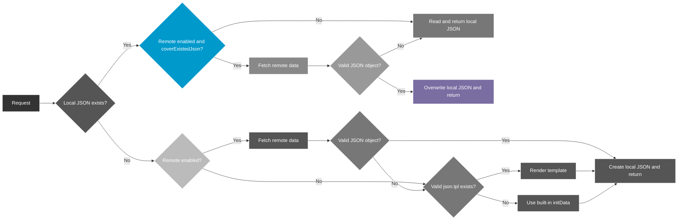

# Initialize local JSON data from a remote service



## 1. Function Triggers

- `setJsonByRemote.enable` is `true`
- `setJsonByRemote.target` is a valid HTTP(S) URL
- Either the local JSON file is missing, or `coverExistedJson` is `true`

When a local JSON file exists and `coverExistedJson` is not `true`, Mihawk does not send a remote request.

## 2. Configuration Parameters

```ts
interface {
  enable: boolean;
  /** Target server URL */
  target: string;
  /** Timeout in milliseconds */
  timeout?: number;
  /** Add the target host as a forwarded Host value; the original lowercase host header is currently retained */
  changeOrigin?: boolean;
  /** Path rewrite function */
  rewrite?: (path: string) => string;
  /** Fetch and overwrite an existing local JSON file */
  coverExistedJson?: boolean;
}
```

`timeout` defaults to `10000` ms. `changeOrigin` and `coverExistedJson` default to disabled.

## 3. Complete Configuration Example

```ts
// .mihawkrc.ts
export default {
  // ...
  setJsonByRemote: {
    enable: true,
    target: 'https://api.example.com',
    timeout: 5000,
    changeOrigin: true,
    coverExistedJson: false,
    rewrite: path => path.replace(/^\/api\/v1/, '/v1'),
  },
  // ...
};
```

## 4. Runtime behavior

1. The request method, headers, cookies, query string, and request body are passed to the remote request. GET and HEAD requests do not forward a body.
2. A successful remote result must be a JSON object. Mihawk adds a `mihawkMessage` field before writing it to the local JSON file.
3. If an existing local file is being covered and the remote request fails or returns an invalid value, Mihawk returns the existing local file.
4. If the local file is missing and the remote request fails, Mihawk tries `json.tpl`, then the built-in `initData`.
5. `coverExistedJson: true` performs the remote request on every matching request and overwrites the local JSON after each valid response.

## 5. URL restrictions

- `target` must use HTTP or HTTPS and must not contain credentials, a query string, or a fragment
- `localhost`, `127.0.0.1`, and `::1` targets are rejected
- The rewritten request path must stay under the target's configured base path; absolute URLs and path traversal are rejected
- Redirect responses are not followed
