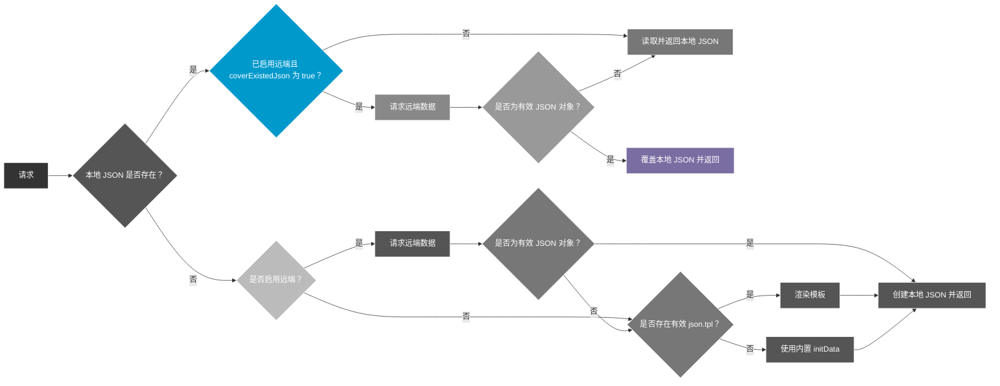

# 用远端接口初始化本地 mock 数据



## 1. 功能触发条件

- `setJsonByRemote.enable` 为 `true`
- `setJsonByRemote.target` 是有效的 HTTP(S) URL
- 本地 JSON 文件不存在，或者 `coverExistedJson` 为 `true`

本地 JSON 已存在且 `coverExistedJson` 不为 `true` 时，Mihawk 不会发送远端请求。

## 2. 配置参数类型

```ts
interface {
  enable: boolean;
  /** 目标服务器URL */
  target: string;
  /** 超时时间（毫秒） */
  timeout?: number;
  /** 将目标 host 添加为转发的 Host 值；当前仍会保留原始的小写 host 请求头 */
  changeOrigin?: boolean;
  /** 路径重写函数 */
  rewrite?: (path: string) => string;
  /** 拉取远端数据并覆盖已有本地 JSON */
  coverExistedJson?: boolean;
}
```

`timeout` 默认是 `10000` 毫秒；`changeOrigin` 和 `coverExistedJson` 默认关闭。

## 3. 完整配置示例

```ts
// .mihawkrc.ts
export default {
  // ...
  setJsonByRemote: {
    enable: true,
    target: 'https://api.example.com',
    timeout: 5000,
    changeOrigin: true,
    coverExistedJson: false,
    rewrite: path => path.replace(/^\/api\/v1/, '/v1'),
  },
  // ...
};
```

## 4. 运行行为

1. 请求方法、headers、cookie、query string 和请求体会传给远端请求；GET 和 HEAD 请求不会转发 body。
2. 成功的远端结果必须是 JSON 对象。Mihawk 写入本地 JSON 前会增加 `mihawkMessage` 字段。
3. 覆盖已有本地文件时，如果远端请求失败或返回值无效，Mihawk 会回退并返回已有本地文件。
4. 本地文件不存在时，如果远端请求失败，Mihawk 会继续尝试 `json.tpl`，最后使用内置 `initData`。
5. `coverExistedJson: true` 会在每次匹配请求时访问远端，并在响应有效时覆盖本地 JSON。

## 5. URL 限制

- `target` 必须使用 HTTP 或 HTTPS，且不能包含用户名密码、query string 或 fragment
- 禁止使用 `localhost`、`127.0.0.1` 和 `::1` 作为目标地址
- rewrite 后的请求路径必须保留在 target 配置的基础路径下；禁止绝对 URL 和路径穿越
- 不跟随远端重定向
